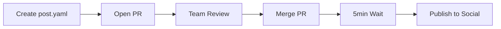

# PolicyEngine Social Media Automation

PR-based social media posting system for PolicyEngine. All posts require review and approval through GitHub Pull Requests before publishing.

## 🔒 Safety First

**This system is designed to NEVER post without explicit approval:**
- All posts must be reviewed via Pull Request
- Posts are only published after PR merge
- 5-minute grace period to cancel after merge
- No local posting capabilities by default

## How It Works



1. **Create Post**: Add a YAML file to `posts/queue/`
2. **Open PR**: Submit for team review
3. **Review**: Team reviews content, accuracy, timing
4. **Merge**: Approved PRs are merged
5. **Grace Period**: 5 minutes to cancel via `/cancel-posts`
6. **Publish**: Automatically posts to configured platforms

## Quick Start

### Creating a Post

1. Copy the example template:
```bash
cp posts/queue/example-post.yaml.example posts/queue/my-post.yaml
```

2. Edit with your content:
```yaml
title: "Your Post Title"
platforms:
  x:
    accounts: [thepolicyengine]
    thread:
      - "First tweet"
      - "Second tweet"
  linkedin:
    content: "LinkedIn post content"
```

3. Open a Pull Request

### Post Format

```yaml
# Metadata
title: "NSF Grant Announcement"
author: "YourName"
tags: ["announcement", "grant"]

# Platform content
platforms:
  x:
    accounts: 
      - thepolicyengine    # Main account
      - policyengineus     # US-specific
      - policyengineuk     # UK-specific
    thread:
      - "Tweet 1 (max 280 chars)"
      - "Tweet 2"
    images: ["assets/image.png"]
  
  linkedin:
    content: |
      Longer form content for LinkedIn
      Can be multiple paragraphs
    article_url: "https://policyengine.org/..."
```

## Local Development (Safe Mode)

### Dry Run Testing

Test your posts locally WITHOUT publishing:

```bash
# Validate post structure
python scripts/validate_post.py posts/queue/my-post.yaml

# Preview what would be posted (DRY RUN)
python scripts/publish_post.py posts/queue/my-post.yaml

# Never use --prod flag locally!
```

### Setup for Development

```bash
# Clone repository
git clone https://github.com/PolicyEngine/policyengine-social.git
cd policyengine-social

# Create virtual environment
python3 -m venv venv
source venv/bin/activate

# Install package
pip install -e ".[dev]"

# Copy environment template (but don't add real credentials!)
cp .env.example .env
```

## GitHub Actions Setup

### Required Secrets

Add these to your GitHub repository settings:

**X (Twitter) Accounts:**
- `X_THEPOLICYENGINE_API_KEY`
- `X_THEPOLICYENGINE_API_SECRET`
- `X_THEPOLICYENGINE_ACCESS_TOKEN`
- `X_THEPOLICYENGINE_ACCESS_TOKEN_SECRET`

- `X_POLICYENGINEUS_API_KEY`
- `X_POLICYENGINEUS_API_SECRET`
- `X_POLICYENGINEUS_ACCESS_TOKEN`
- `X_POLICYENGINEUS_ACCESS_TOKEN_SECRET`

- `X_POLICYENGINEUK_API_KEY`
- `X_POLICYENGINEUK_API_SECRET`
- `X_POLICYENGINEUK_ACCESS_TOKEN`
- `X_POLICYENGINEUK_ACCESS_TOKEN_SECRET`

**LinkedIn (via Zapier):**
- `ZAPIER_LINKEDIN_WEBHOOK`

## Repository Structure

```
posts/
├── queue/          # Posts awaiting review (PRs)
├── published/      # Archive of published posts
└── templates/      # Reusable templates

scripts/
├── validate_post.py    # Validates YAML structure
└── publish_post.py     # Posts to social (Actions only)

src/policyengine_social/
├── publishers/
│   ├── x_multi.py      # Multi-account X posting
│   └── zapier.py       # LinkedIn via Zapier
├── extract.py          # Blog image extraction
└── generate.py         # Auto-generate posts
```

cards/                  # Share cards: images drawn from a text file per campaign
├── campaigns/<name>/cards.toml   # the words on each card
├── campaigns/<name>/rendered/    # the PNGs and PDFs, drawn by the Render cards action
└── make_cards.py

## Share cards

`cards/` draws the images that go with posts, from one text file per campaign. Edit a campaign's `cards.toml` on GitHub and the **Render cards** action draws the cards and commits them back to the branch; it never posts. See [cards/README.md](cards/README.md).

## Content Routing

The system automatically routes content to appropriate accounts:

- **US content** → @policyengineus
- **UK content** → @policyengineuk  
- **General** → @thepolicyengine

## Testing

```bash
# Run all tests
pytest tests/

# Run with coverage
pytest tests/ --cov=policyengine_social

# Validate a post
python scripts/validate_post.py posts/queue/my-post.yaml
```

## Safety Features

1. **No Accidental Posting**: Package cannot post without explicit PR approval
2. **Review Required**: All posts go through PR review
3. **Cancellation Window**: 5 minutes to cancel after merge
4. **Dry Run Default**: Scripts default to preview mode
5. **Validation**: Posts are validated before publishing
6. **Audit Trail**: All posts archived after publishing

## PR Workflow

1. Create your post YAML in `posts/queue/`
2. Run validation locally: `python scripts/validate_post.py posts/queue/my-post.yaml`
3. Preview locally: `python scripts/publish_post.py posts/queue/my-post.yaml`
4. Commit and push: `git add posts/queue/my-post.yaml && git commit -m "Add post about..."`
5. Open PR and fill out the template
6. Wait for team review
7. Merge when approved
8. Monitor the Actions tab for publishing status

## Troubleshooting

### Post Not Publishing
- Check GitHub Actions logs
- Verify all secrets are set correctly
- Ensure post YAML is valid

### Wrong Account
- Check the `accounts` field in your YAML
- Verify content routing rules

### Rate Limits
- X allows 300 posts per 3 hours
- Space out large threads
- Use different apps for different accounts

## Contributing

1. Never add real credentials to code
2. Always use dry-run mode for testing
3. Create posts via PR only
4. Test thoroughly with `pytest`

## License

MIT